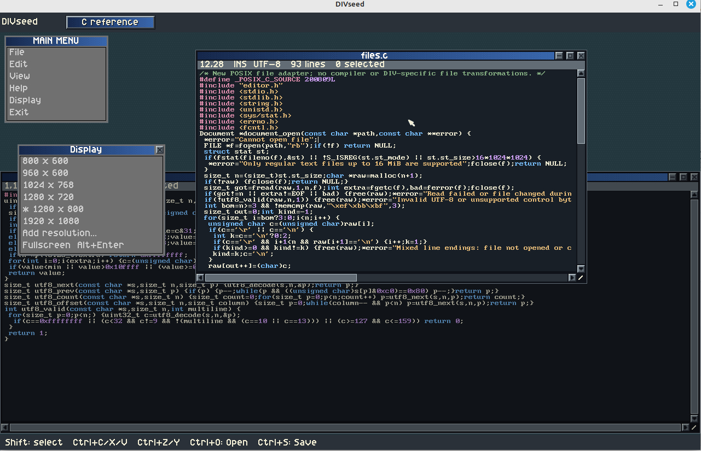

# DIVseed — alpha 0.4

DIVseed is a small Linux text editor derived from DIV Games Studio 2. This AI-assisted experiment brings DIV's bitmap fonts, raised buttons, floating menus, and desktop animations to a multi-document editor with built-in C tools.

Full credit to Daniel Navarro, the original programmer DIV Games Studio, and MikeDX, for his work porting DIV Games Studio to modern systems. (https://github.com/DIVGAMES/DIV-Games-Studio)



## Build and launch

Requires a C compiler, Make, pkg-config, and SDL2 development libraries (2.0.18 or newer). On Debian or Ubuntu, install them with `sudo apt install build-essential pkg-config libsdl2-dev`.

```sh
make
./divseed
./divseed file.txt "another file.c"
```

Keep `assets/` beside the executable. `make deps` offers to install missing dependencies on Debian, Ubuntu, Fedora, or Arch. `make run` launches the editor, and `make clean` removes build files. Use `--` before a filename that starts with a dash.

## Editing and navigation

| Shortcut | Action |
| --- | --- |
| `Ctrl+N`, `Ctrl+O` | New document, open file |
| `Ctrl+S`, `Ctrl+Shift+S`, `Ctrl+W` | Save, Save As, close document |
| `Ctrl+C`, `Ctrl+X`, `Ctrl+V` | Copy, cut, paste |
| `Ctrl+Z`, `Ctrl+Y` | Undo, redo |
| `Ctrl+L` | Show or hide line numbers in the active editor window |
| `Ctrl+G` | Jump to the first column of a line |
| `Home`, `End` | Jump to the beginning or end of the file |
| `Page Up`, `Page Down` | Move one visible page. Keypad `9` and `3` work with Num Lock off |
| `F1` | Open Help |

Hold Shift while navigating to extend the selection. Tab inserts four spaces in the editor. Existing tab bytes are preserved and rendered as blank cells.

In the file picker, Tab and Shift+Tab cycle through the filename, directories, files, filter, Accept, and Cancel. Enter activates the focused control. Confirmation dialogs also support Tab and Enter. Within text fields, Home and End move to the ends of the field, and Ctrl+A clears it.

## Find and Replace

Use **Edit → Find** (`Ctrl+F`) or **Edit → Replace** (`Ctrl+H`) to search for literal UTF-8 text in the active document. Search ignores case by default and wraps at the end of the document. Check **Match case** to require exact capitalization. The setting is shared across both dialogs for the session.

Enter finds the next match. Tab moves focus, Space toggles the focused checkbox, and Esc closes the dialog. Find Next selects the matching text and highlights the whole line in amber. The highlight stays visible after closing the dialog while the match remains selected.

Replace updates one match, and Replace All is one undoable edit. An empty replacement deletes the matched text. Search fields accept up to 511 bytes.

## C tools

C syntax colors are enabled automatically for `.c` and `.h` files. Use **View → Toggle C colors** (`Ctrl+K`) to change the active window's setting. **Help → C reference** opens scrollable keyword reminders based on the [C11 draft](https://www.open-std.org/jtc1/sc22/wg14/www/docs/n1570.pdf).

| Command | Action |
| --- | --- |
| **File → Compile** (`F5`) | Compile one saved `.c` file and show diagnostics. The object file is discarded. |
| **File → Run** (`F7`) | Compile, link, and run a saved standalone `.c` program in a temporary executable. |
| **File → Terminal output** (`F6`) | Open the scrollable DIV output window. Press F6 again to hide it. |

DIVseed looks for GCC on `PATH` first, then Clang. Compile and Run are disabled if neither is available. Save your changes before using either command. Run captures standard output, standard error, and the exit code. It is intended for short, noninteractive text programs, with no keyboard input and a 10-second runtime limit plus an output limit.

## Desktop and display

Drag windows and menus by their title bars. Resize editor windows from the bottom-right corner. Covered windows and menus dim, and the close button sits over the menu title gradient. The small floating clock starts in the upper-right corner, shows local time in 24-hour format, and can be dragged like a menu.

The DIVseed name bar sits behind the windows, so maximized editor windows can reach the top edge. The shortcut bar remains at the bottom.

The desktop starts at **960×600**. The Display menu offers preset resolutions and up to six custom sizes per session, from **800×600** to **3840×2160**. Press **Alt+Enter** to toggle desktop fullscreen. The renderer uses hardware-accelerated VSync when available and falls back to software rendering.

## Text format and license

DIVseed supports UTF-8 and preserves a file's uniform LF, CRLF, or CR line endings. Files with mixed line endings are rejected. The bitmap editor displays one cell per Unicode scalar with limited glyph coverage. Saves use a temporary file and check for on-disk changes before replacing the original.

DIVseed is licensed under [GPLv3](LICENSE) and based on [DIV Games Studio](https://github.com/DIVGAMES/DIV-Games-Studio). See [NOTICE](NOTICE) and the [Unicode font license](assets/UNICODE-FONT-LICENSE) for attribution.
